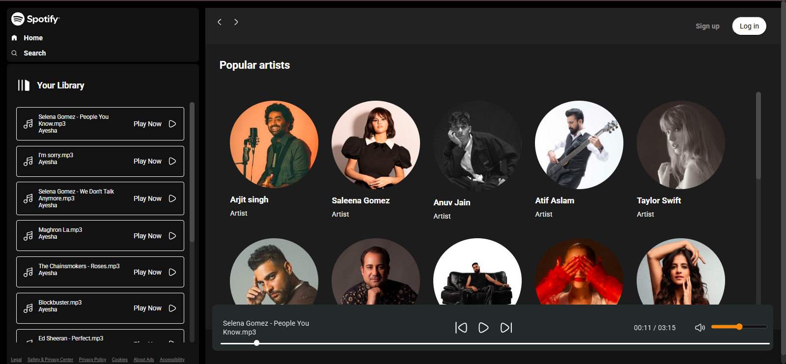

# Music Streaming App

A Spotify-inspired music player built with HTML, CSS and vanilla JavaScript.

## Features
- Play / pause songs
- Next and previous track controls
- Seek bar showing song progress
- Song list loaded from the `songs` folder
- Responsive layout

## Tech Stack
HTML5 · CSS3 · JavaScript (DOM manipulation, Audio API)

## What I Practiced
- Controlling audio playback with JavaScript
- Updating the UI dynamically based on app state
- Structuring a project into separate css / js / assets folders

## Run Locally
1. Clone the repo: `git clone https://github.com/AyeshaAfzal-01/Music-Streaming-App.git`
2. Open `index.html` in your browser

## Screenshot

## Live Demo
[https://musicstreamingapp-orcin.vercel.app/]

## Future Improvements
- Add a backend (Node.js + MongoDB) for user accounts and playlists
- Search and favorites
